## 👋 About

🎓 MMath graduate.

🧠 I'm interested in why training neural networks works at all: how gradient-based optimisation behaves on nonconvex losses, and how that connects to generalisation.

📐 What I like working through: conditioning and momentum in optimisation, adaptive methods like Adam, how a small network carves up its input space, attention, and backpropagation.

🔬 Every animation here is computed from the maths, not drawn by hand: real optimiser paths, a network actually trained on two moons, attention weights from toy positional queries and keys, and the real forward and backward pass.

 

 

