## About

MMath graduate. I'm interested in why training neural networks works at all: how gradient-based optimisation behaves on nonconvex losses, and how that connects to generalisation.

- Optimisation, loss landscapes, backpropagation, statistical learning
- Python day to day, on Arch with Hyprland and Neovim. The whole setup is public in [system](https://github.com/knowvw/system)

---

## Tools

---

