## 👋 About

🎓 MMath graduate.

🧠 I'm interested in why training neural networks works at all: how gradient-based optimisation behaves on nonconvex losses, and how that connects to generalisation.

## 🔭 Focus

- 📉 Nonconvex optimisation and loss landscapes
- 🔁 Backpropagation
- 🎯 Generalisation and statistical learning

## 🛠️ Tools

 

 

